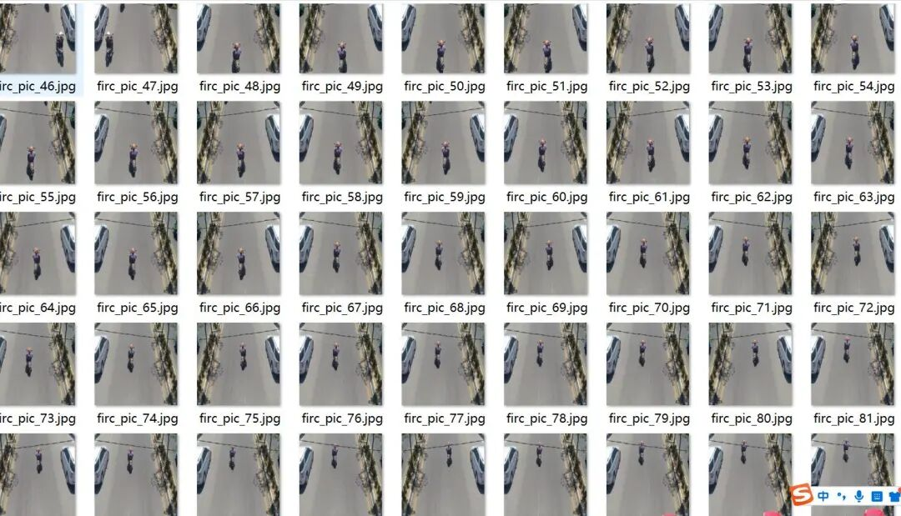
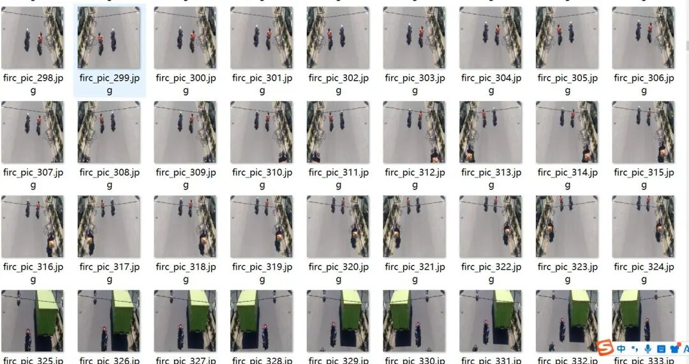
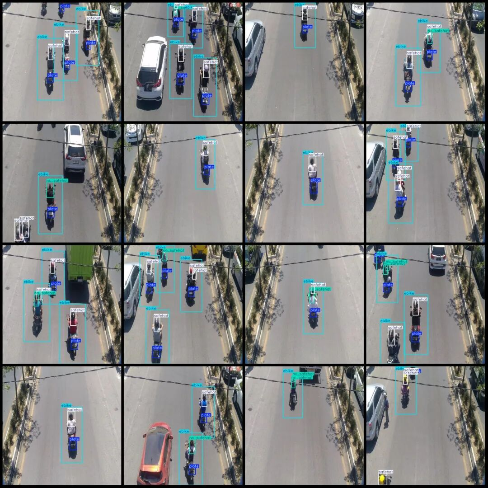
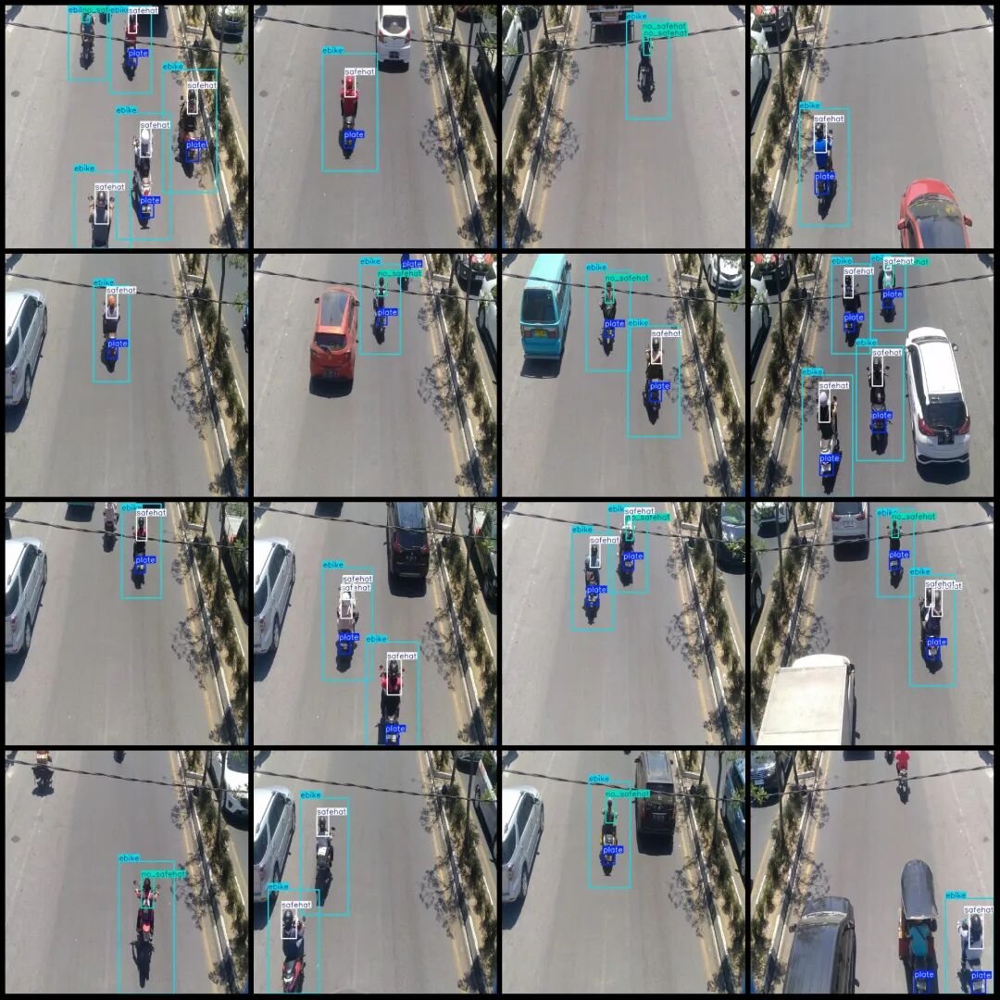

# Road Vehicle Motorcycle Helmet Wearing Detection Dataset VOC+YOLO format with 2308 images in 4 categories

Dataset format: Pascal VOC format + YOLO format (txt file without split path, only containing jpg images and corresponding VOC format xml files and yolo format txt files)

Number of images (number of jpg files): 2308

Number of annotations (number of xml files): 2308

Number of annotations (number of txt files): 2308

Labeling category count: 4

Label category names (Note that the order of categories in the YOLO format does not correspond to this, but is based on the labels folder's classes.txt): ["ebike", "no_safehat", "plate", "safehat"]

Number of boxes labeled in each category:

Ebike (electric bicycle) frame count = 4460

No_safehat (no safety hat) frame count = 1448

Plate (license plate) frame count = 4865

Safehat (wearing a safety hat) frame count = 4400

Total frame count: 15173

Number of images per category:

E-bike (electric bicycle) has 2287 images.

no_safehat (not wearing a safety hat) has 1239 images.

Plate (license plate) count = 2164

safehat (wearing a safety hat) has 2111 images.

Image resolution: 640x640

Using labelImg:

Annotation rules: Draw a rectangle around the category.

Important Notice: The dataset does not have separate training, validation, and test sets; you need to partition them yourself.

Special : This dataset does not guarantee the accuracy of the trained models or weight files.

Image Preview:

Annotation example:

## Payment

Here is a pay link on Stripe ( https://buy.stripe.com/3cs8yP7sY87d0vu9AB ). Please contact me lonlonago@foxmail.com after funding $89, and I will send you a complete data files , thank you!

